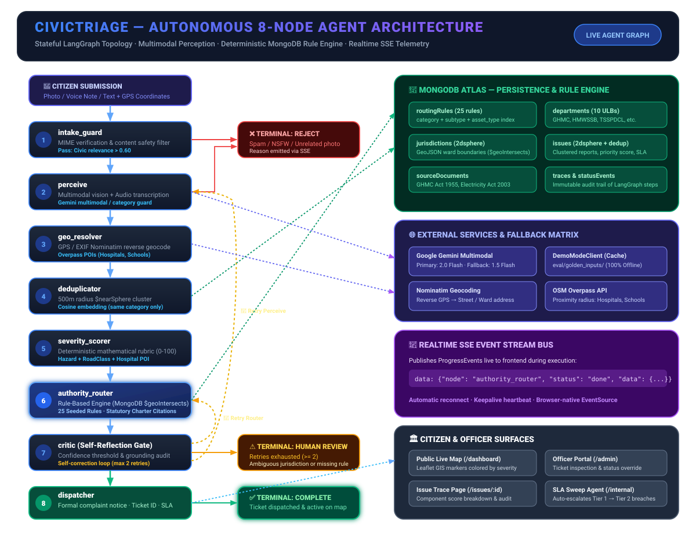

# CivicTriage

> **Autonomous AI Civic Grievance Triage System**  
> Multimodal citizen reports → correctly routed, SLA-bound municipal complaints in under 30 seconds.

---

## 🌐 Live Production Deployments

| Component | Production URL | Status |
| :--- | :--- | :--- |
| **Frontend Web App** | [frontend-kappa-seven-ar0aabmczr.vercel.app](https://frontend-kappa-seven-ar0aabmczr.vercel.app) | **Live & Operational** |
| **Mirror Domain** | [nxtwavehackathon.vercel.app](https://nxtwavehackathon.vercel.app) | **Live & Operational** |
| **FastAPI Backend** | [backend-peach-xi-25.vercel.app](https://backend-peach-xi-25.vercel.app) | **Live (MongoDB Atlas)** |
| **Public Dashboard** | [frontend-kappa-seven-ar0aabmczr.vercel.app/dashboard](https://frontend-kappa-seven-ar0aabmczr.vercel.app/dashboard) | **Live & Operational** |
| **Supervisor / Admin Console** | [frontend-kappa-seven-ar0aabmczr.vercel.app/admin](https://frontend-kappa-seven-ar0aabmczr.vercel.app/admin) | **Live & Operational** |

---

## Problem at a Glance

India's civic grievance ecosystem is broken. Citizens report infrastructure failures — potholes, burst water mains, downed streetlights — but complaints are misrouted, duplicated, lost, or ignored. CivicTriage fixes the three root causes:

1. **Wrong routing** — AI + deterministic rule engine routes to the *exact* responsible department, not a generic inbox
2. **Duplicate noise** — Geo-spatial + semantic deduplication clusters 47 reports of the same pothole into one growing issue
3. **Zero accountability** — Every complaint carries a statutory citation, SLA deadline, and an immutable audit trail

---

## Live Demo

| Screen | Description |
|---|---|
| `/` | Mobile-first capture: camera, voice note, GPS, or one of 4 demo presets |
| `/reports/:id/progress` | Live SSE stream — watch all 8 agent steps complete in real time |
| `/issues/:id` | Issue file: severity breakdown, routing justification, legal notice, audit trace |
| `/dashboard` | Public accountability map: severity-coded markers, department leaderboard |
| `/admin` | Officer portal: ticket management, SLA sweep trigger |

**Demo presets available on the submission page** (pre-filled GPS + description):
- 🚧 Deep Pothole — Road No. 36, near Apollo Hospital (Critical, SLA ≤ 4h)
- 💧 Water Main Rupture — Hi-Tec City Main Road (High, SLA ≤ 24h)
- 💡 Dark Streetlight + Exposed 230V Wire — Banjara Hills Road 12 (Critical)
- 🗑️ Toxic Waste Burning near School — Secunderabad Station Road (High)

---

## Agent Graph & Architecture

The CivicTriage agent pipeline is orchestrated as a stateful **LangGraph `StateGraph`** with dynamic feedback loops, deterministic quality gates, and real-time Server-Sent Events (SSE) telemetry.

### Visual Agent Architecture & Node Connection Graph



---

### Conditional Edge Logic

| From | Condition | To |
|---|---|---|
| **Intake Guard** | `is_valid = false` or pipeline error | `TERMINAL_REJECT` |
| **Intake Guard** | `is_valid = true` | `Perceive` |
| **Perceive** | `image_matches_description = false` or error | `TERMINAL_REJECT` |
| **Perceive** | success | `Geo Resolver` |
| **Geo Resolver** | always | `Deduplicator` |
| **Deduplicator** | always | `Severity Scorer` |
| **Severity Scorer** | always | `Authority Router` |
| **Authority Router** | always | `Critic` |
| **Critic** | `passed = true` | `Dispatcher` |
| **Critic** | `retry_target = "perceive"` and retries remaining | `Perceive` ↩ |
| **Critic** | `retry_target = "authority_router"` and retries remaining | `Authority Router` ↩ |
| **Critic** | retries exhausted **and** core outputs present | `Dispatcher` (proceed anyway) |
| **Critic** | retries exhausted **or** `human_review` flagged | `TERMINAL_HUMAN_REVIEW` |
| **Dispatcher** | always | `TERMINAL_DONE` |

**Orchestration**: LangGraph typed state machine (conditional retry edges + early-exit paths)  
**Routing**: MongoDB `routingRules` collection — 25 seeded deterministic rules, `2dsphere` geo-indexed `jurisdictions`  
**Severity**: Deterministic rubric (`hazard + road_class + proximity + area + cluster_size`) — LLM only extracts features  
**Dedup**: `$nearSphere` geo-radius + `text-embedding-004` cosine similarity, defect-family isolation prevents cross-category merges

---

## Tech Stack

| Layer | Technology |
|---|---|
| Backend | Python 3.12, FastAPI (async) |
| Agent Pipeline | LangGraph |
| Primary LLM | Gemini 2.0 Flash (vision + text) |
| Fallback LLM | Gemini 1.5 Flash |
| Database | MongoDB Atlas (`2dsphere` + compound indexes) |
| Embeddings | Google `text-embedding-004` (768-dim) |
| Reverse Geocode | Nominatim (OSM) |
| POI Discovery | OSM Overpass API |
| Realtime | Server-Sent Events |
| Frontend | React 18, Vite, Tailwind CSS, Leaflet.js |

---

## Quick Start

### Prerequisites

- Python 3.12+
- Node.js 18+ and npm / pnpm
- MongoDB Atlas cluster (free tier works) — or set `DEMO_MODE=true` to skip
- Google AI API key (Gemini) — or set `DEMO_MODE=true` to skip

### 1. Clone the Repository

```bash
git clone https://github.com/your-org/NxtWave_Hackathon.git
cd NxtWave_Hackathon
```

### 2. Backend Setup

```bash
cd civictriage/backend

# Create virtual environment
python -m venv .venv
.venv\Scripts\activate        # Windows
# source .venv/bin/activate   # macOS / Linux

# Install dependencies
pip install -r requirements.txt

# Configure environment
cp .env.example .env
```

Edit `.env` and fill in:

```env
# Required for live mode
MONGODB_URI=mongodb+srv://<user>:<pass>@cluster.mongodb.net/civictriage
GOOGLE_API_KEY=AIza...

# Optional — set to true for fully offline demo mode
DEMO_MODE=false

# Admin portal token
ADMIN_TOKEN=your-secret-token-here

# App settings (defaults are fine)
MONGODB_DB=civictriage
PRIMARY_MODEL=gemini-2.0-flash
FALLBACK_MODEL=gemini-1.5-flash
EMBED_MODEL=models/text-embedding-004
EMBED_DIMENSION=768
DEDUP_RADIUS_METERS=500
DEDUP_SIMILARITY_THRESHOLD=0.75
```

```bash
# Seed database (departments, routing rules, jurisdictions, authorities)
python seed/seed_rules.py
python seed/seed_authorities.py

# Start API server
uvicorn app.main:app --reload --port 8000
```

API docs available at: `http://localhost:8000/docs`

### 3. Frontend Setup

```bash
cd civictriage/frontend

# Install dependencies
npm install           # or: pnpm install

# Configure API URL
echo "VITE_API_BASE_URL=http://localhost:8000" > .env.local

# Start dev server
npm run dev           # or: pnpm dev
```

Frontend available at: `http://localhost:5173`

---

### 4. Vercel Production Deployment

CivicTriage is production-ready for deployment on **Vercel** with full configuration presets:

- **1-Click Monorepo Deployment**: Import repository root on Vercel; root `vercel.json` and `package.json` build the Vite SPA automatically.
- **Microservices Deployment**:
  - Deploy `civictriage/backend` as a Serverless Python API (native `api/index.py` + `requirements.txt`).
  - Deploy `civictriage/frontend` as a Vite SPA (set `VITE_API_BASE_URL` to backend URL).
- Comprehensive instructions, environment variables list, and edge headers are detailed in [**`VERCEL_DEPLOYMENT_GUIDE.md`**](VERCEL_DEPLOYMENT_GUIDE.md).

---

### 5. (Optional) MongoDB Atlas Indexes

If using MongoDB Atlas with live embeddings, create these vector/geo indexes in the Atlas UI:

**`civictriage.issues`** — Geospatial (for deduplication):
```json
{ "location": "2dsphere" }
```

**`civictriage.jurisdictions`** — Geospatial (for routing):
```json
{ "boundary": "2dsphere" }
```

**`civictriage.issues`** — Vector Search index (Atlas Search):
```json
{
  "mappings": {
    "dynamic": false,
    "fields": {
      "embedding": {
        "dimensions": 768,
        "similarity": "cosine",
        "type": "knnVector"
      }
    }
  }
}
```

### 5. Run Tests

```bash
cd civictriage/backend
python -m pytest tests/ -v
```

### 6. Run Evaluation Benchmark

```bash
cd civictriage/backend
python eval/run_eval.py
```

Expected output:
```
Category Classification Accuracy:   100.0%  (5/5)
Severity Tier Agreement (Hybrid):    100.0%  (5/5)
Jurisdictional Routing Accuracy:     100.0%  (5/5)
Legal/Charter Citation Rate:         100.0%  (5/5)
```

---

## Demo Mode (Fully Offline)

Set `DEMO_MODE=true` in `.env` to run the complete 8-node pipeline with zero network calls:
- No LLM API calls — uses golden JSON cache from `eval/golden_inputs/`
- No MongoDB Atlas — uses an in-process `InMemoryDatabase` (auto-seeded on startup)
- No geo APIs — uses cached geocode responses
- Deterministic outputs every time — ideal for live demonstrations

```bash
# .env
DEMO_MODE=true
```

---

## Project Structure

```
NxtWave_Hackathon/
├── PROBLEM_STATEMENT.md           # Track submission: problem definition
├── SOLUTION_DESCRIPTION.md        # Track submission: solution architecture
├── README.md                      # This file
└── civictriage/
    ├── backend/
    │   ├── app/
    │   │   ├── main.py                     # FastAPI app + lifespan
    │   │   ├── api/routers/
    │   │   │   ├── reports.py              # POST /reports, SSE stream
    │   │   │   ├── issues.py               # GET /issues, issue detail
    │   │   │   ├── dashboard.py            # Stats, authority leaderboard
    │   │   │   └── admin.py                # Officer portal, SLA sweep
    │   │   ├── agents/
    │   │   │   ├── nodes/
    │   │   │   │   ├── intake_guard.py     # Node 1: validation
    │   │   │   │   ├── perceive.py         # Node 2: multimodal perception
    │   │   │   │   ├── geo_resolver.py     # Node 3: GPS/EXIF/geocode
    │   │   │   │   ├── deduplicator.py     # Node 4: geo-cluster merge
    │   │   │   │   ├── severity_scorer.py  # Node 5: priority rubric
    │   │   │   │   ├── authority_router.py # Node 6: rule-based routing
    │   │   │   │   ├── critic.py           # Node 7: validation + retry
    │   │   │   │   └── dispatcher.py       # Node 8: ticket + audit
    │   │   │   └── sla_escalation_agent.py # Autonomous SLA sweep
    │   │   ├── services/
    │   │   │   ├── pipeline.py             # LangGraph compilation + runner
    │   │   │   ├── geo_service.py          # Nominatim + Overpass
    │   │   │   ├── embed_service.py        # Embedding + cosine similarity
    │   │   │   └── sla_service.py          # SLA deadline logic
    │   │   ├── models/
    │   │   │   ├── schemas.py              # All Pydantic schemas
    │   │   │   ├── db_models.py            # MongoDB document shapes
    │   │   │   └── graph_state.py          # CivicTriageState TypedDict
    │   │   └── core/
    │   │       ├── config.py               # Pydantic Settings
    │   │       ├── database.py             # Motor client + InMemoryDB fallback
    │   │       ├── llm_client.py           # Gemini client + DemoModeClient
    │   │       └── sse_bus.py              # In-process SSE event bus
    │   ├── seed/
    │   │   ├── seed_rules.py               # Seeds 25 routing rules, jurisdictions
    │   │   ├── seed_authorities.py         # Seeds authorities + KB chunks
    │   │   ├── authorities.json            # Hyderabad authority directory
    │   │   └── atlas_vector_indexes.json   # Atlas Search index config
    │   ├── eval/
    │   │   ├── run_eval.py                 # 5-case evaluation benchmark
    │   │   └── golden_inputs/              # Labeled test cases (JSON + images)
    │   ├── tests/
    │   │   ├── test_clustering_dedup.py    # 5 deduplication unit tests
    │   │   └── test_rule_engine.py         # 35 routing rule engine tests
    │   ├── requirements.txt
    │   └── .env.example
    └── frontend/
        ├── src/
        │   ├── api/
        │   │   ├── client.ts               # Typed fetch wrapper
        │   │   └── types.ts                # TypeScript schema mirrors
        │   ├── hooks/useSSE.ts             # SSE hook with reconnect
        │   ├── pages/
        │   │   ├── SubmitPage.tsx          # Mobile-first capture + presets
        │   │   ├── ProgressPage.tsx        # Live SSE progress viewer
        │   │   ├── IssuePage.tsx           # Issue detail + audit trace
        │   │   ├── DashboardPage.tsx       # Map + stats + leaderboard
        │   │   └── AdminPage.tsx           # Officer portal
        │   ├── components/
        │   │   ├── ProgressTracker.tsx     # 8-node agent pipeline visualization
        │   │   ├── SeverityGauge.tsx       # Animated priority score gauge
        │   │   ├── ReportCard.tsx          # Issue list card
        │   │   └── TicketBadge.tsx         # Formal ticket display
        │   └── map/IssueMap.tsx            # Leaflet severity-coded map
        └── package.json
```

---

## API Reference

| Method | Path | Description |
|--------|------|-------------|
| `POST` | `/reports` | Submit a civic report (`multipart/form-data`: `file`, `description`, `gps_lat`, `gps_lng`) |
| `GET` | `/reports/{id}/stream` | SSE stream of real-time agent progress events |
| `GET` | `/issues` | List issues (`bbox`, `category`, `status`, `severity` filters) |
| `GET` | `/issues/{id}` | Issue detail with 8-node trace + score breakdown |
| `POST` | `/issues/{id}/confirm` | Citizen confirms existing issue (+1 cluster weight) |
| `GET` | `/dashboard/stats` | Aggregate statistics |
| `GET` | `/authorities/leaderboard` | Department SLA performance ranking |
| `GET` | `/admin/tickets` | Municipal ticket list (requires `Authorization: Bearer <ADMIN_TOKEN>`) |
| `PATCH` | `/admin/tickets/{id}` | Update ticket status (admin only) |
| `POST` | `/internal/sla-sweep` | Trigger autonomous SLA escalation agent |

---

## Architecture Decisions

- **Separation of LLM and rules**: LLM extracts features; deterministic code makes decisions. This keeps outputs auditable and legally defensible.
- **InMemoryDatabase fallback**: If MongoDB Atlas is unreachable, the system continues running with full functionality using an in-process database pre-seeded from JSON seed files.
- **Demo mode golden cache**: `eval/golden_inputs/` contains pre-computed outputs for all 8 nodes and 5 issue categories — the pipeline runs end-to-end without any external APIs.
- **Category-feature consistency guard**: `_reconcile_visual_observation()` in `perceive.py` detects and corrects cross-category contamination (e.g., water pipeline data appearing in a streetlight report) by checking each output field against category-incompatible terminology.
- **Defect-family dedup isolation**: The deduplicator enforces that reports from disjoint defect families (pothole vs. streetlight at the same intersection) are never merged into a single issue cluster.
- **SSE in-process bus**: No Redis or external message broker required for the demo — the `SSEBus` is an asyncio-native in-memory pub/sub that works in a single Uvicorn worker.

---

## Evaluation & Tests

```
Tests:      40 / 40 passing  (pytest)
Benchmark:  5  / 5  golden cases — 100% on all 4 metrics
Build:      tsc && vite build — 0 TypeScript errors, 0 warnings
```
