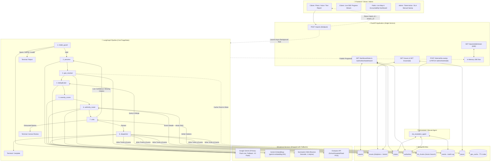
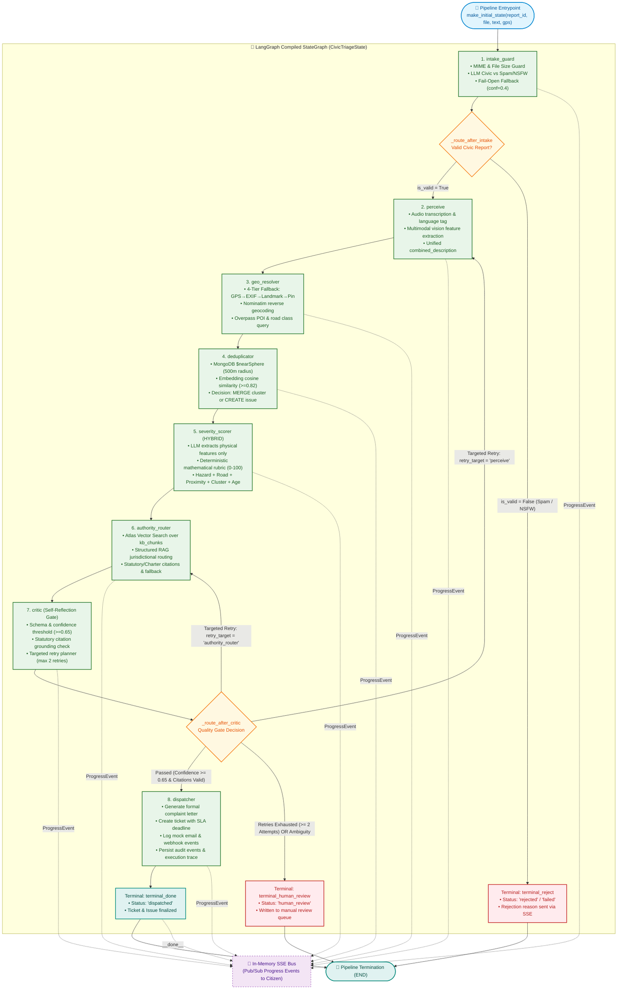
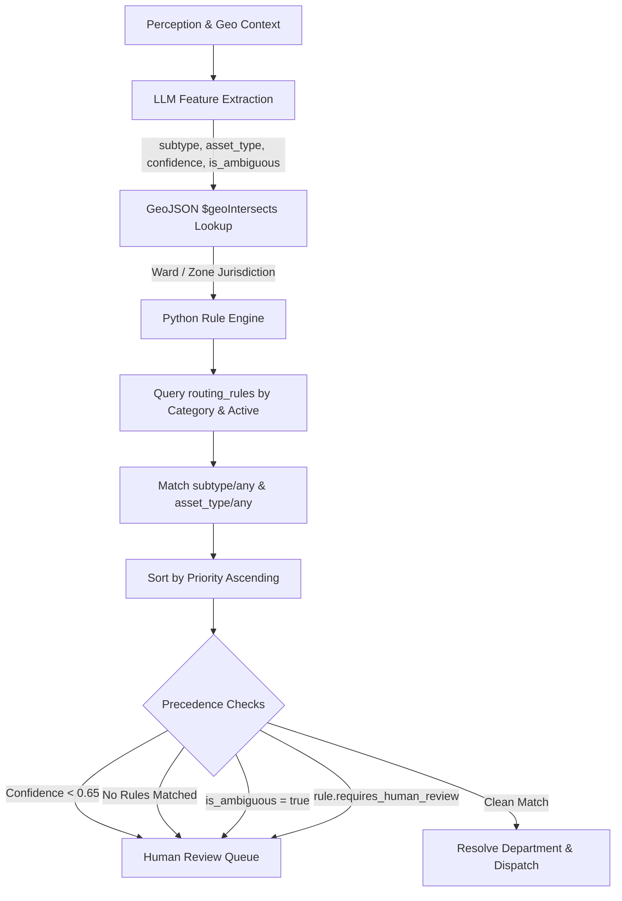
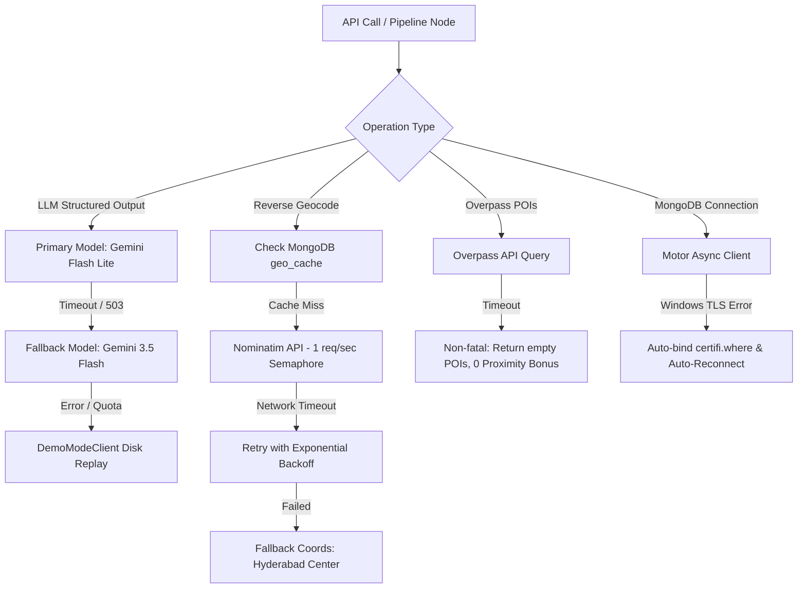

# CivicTriage — Backend Architecture & System Guide

> **A Comprehensive Technical Walkthrough of the CivicTriage Backend**  
> Stack: Python 3.12/3.13 · FastAPI (async) · LangGraph · MongoDB Atlas · Google Gemini Multimodal · OpenStreetMap (Nominatim & Overpass)

> **⚠️ Architecture Update (Nov 2026):** Node 6 (`authority_router`) has been refactored from a RAG-based system to a **deterministic Rule-Based Routing Engine** backed by MongoDB `routing_rules`, `departments`, and `jurisdictions` collections. See [Node 6](#node-6-authority_router) and [Rule-Based Routing Engine](#rule-based-routing-engine) for details.

---

## Table of Contents
1. [System Overview & Philosophy](#1-system-overview--philosophy)
2. [High-Level Architecture Diagram](#2-high-level-architecture-diagram)
3. [End-to-End Request Lifecycle](#3-end-to-end-request-lifecycle)
4. [The 8-Node LangGraph Agent Pipeline](#4-the-8-node-langgraph-agent-pipeline)
   - [Agent Graph Topology & State Flow](#agent-graph-topology--state-flow)
   - [Node 1: intake_guard](#node-1-intake_guard)
   - [Node 2: perceive](#node-2-perceive)
   - [Node 3: geo_resolver](#node-3-geo_resolver)
   - [Node 4: deduplicator](#node-4-deduplicator)
   - [Node 5: severity_scorer](#node-5-severity_scorer)
   - [Node 6: authority_router](#node-6-authority_router)
   - [Node 7: critic](#node-7-critic)
   - [Node 8: dispatcher](#node-8-dispatcher)
   - [Terminal Nodes](#terminal-nodes)
5. [Rule-Based Routing Engine](#rule-based-routing-engine)
6. [Autonomous SLA Escalation Agent](#5-autonomous-sla-escalation-agent)
7. [Database Schema & Indexing Strategy](#6-database-schema--indexing-strategy)
8. [Resilience, Fallbacks & Fault Tolerance](#7-resilience-fallbacks--fault-tolerance)
9. [Realtime Server-Sent Events (SSE) Bus](#8-realtime-server-sent-events-sse-bus)
10. [API Surface & Router Layer](#9-api-surface--router-layer)
11. [Configuration & Environment Management](#10-configuration--environment-management)

---

## 1. System Overview & Philosophy

**CivicTriage** is an autonomous grievance triage engine. It transforms raw, unstructured citizen inputs (noisy photos from mobile phones, voice notes in regional languages, brief text descriptions) into structured, prioritized, deduplicated, and officially dispatched government tickets.

### Core Architectural Principles
1. **Deterministic Severity over LLM Guesswork**: An LLM should extract concrete physical observations (e.g., "pothole diameter > 1 meter", "exposed live electrical wire"). The severity score (0–100) is computed by a **pure mathematical rubric** incorporating road classification, proximity to schools/hospitals, cluster size, and aging. Every single point is auditable.
2. **Deterministic Routing via Rule Engine**: Department identification uses a MongoDB-backed rule engine with explicit precedence. The LLM extracts `subtype` and `asset_type`; a Python rule engine deterministically matches these against `routing_rules`. No ambiguity is silently accepted.
3. **Never Guess Silently (The Critic Pattern)**: If visual confidence is low, routing rules are missing, or coordinates are ambiguous, the pipeline does not guess. The `critic` node loops back with targeted recovery or routes to a human-review queue.
4. **Transparent Audit Trail**: Every node appends an immutable `AuditEvent` to state. The final dispatcher writes these events into an append-only MongoDB `events` collection and generates an execution trace in `traces`.
5. **Resilience & Demo-Safety (`DEMO_MODE`)**: Every external service (LLM, Nominatim, Overpass, Atlas) has a defined fallback, timeout, exponential backoff retry, and local cache. In the event of network failure, `DEMO_MODE=true` replays pre-cached golden outputs seamlessly.

---

## 2. High-Level Architecture Diagram



---

## 3. End-to-End Request Lifecycle

1. **Submission (`POST /reports`)**:
   - The citizen sends a `multipart/form-data` payload containing an image, audio clip, or text, alongside optional device GPS coordinates.
   - The route handler validates basic size limits (default 20MB), saves the file locally in `uploads/{report_id}/`, and inserts an initial document in `reports` with `status="queued"`.
   - The route immediately responds with `202 Accepted`:
     ```json
     {
       "report_id": "7f8b9c2a-...",
       "stream_url": "/reports/7f8b9c2a-.../stream",
       "status": "queued",
       "message": "Report queued. Connect to stream_url for live updates."
     }
     ```
   - An asynchronous task is dispatched to `FastAPI.BackgroundTasks` invoking `PipelineRunner.run()`.

2. **Realtime Connection (`GET /reports/{id}/stream`)**:
   - The frontend connects to the `stream_url` via the HTML5 `EventSource` API (or custom reconnecting hook `useSSE.ts`).
   - Every node in the pipeline emits structured `ProgressEvent` objects containing `{node, status, message, data, timestamp}`.
   - The stream terminates cleanly when the terminal node emits a final `__done__` event.

3. **Pipeline Processing**:
   - The state transitions through the 8 LangGraph nodes sequentially.
   - If the report passes all quality gates, a formal complaint ticket is created, mock emails/webhooks are logged, and the issue appears live on the map.

---

## 4. The 8-Node LangGraph Agent Pipeline

All nodes operate on a single shared, strongly typed state object: `CivicTriageState` (defined in [`models/graph_state.py`](../backend/app/models/graph_state.py)).

### Agent Graph Topology & State Flow

The LangGraph pipeline compiles 8 processing nodes, 3 terminal nodes, 2 conditional routers, and targeted feedback loops into an executable directed state graph:



#### Graph Transition & Routing Rules

| Transition / Edge | Source Node | Destination Node | Condition / Trigger |
| :--- | :--- | :--- | :--- |
| **`_route_after_intake` (Pass)** | `intake_guard` | `perceive` | Report is civic, under 20MB, supported MIME type, not spam/NSFW. |
| **`_route_after_intake` (Reject)** | `intake_guard` | `terminal_reject` | Spam, NSFW, empty payload, unsupported MIME type, or file too large. |
| **Sequential 1** | `perceive` | `geo_resolver` | Multimodal perception complete; `PerceptionOutput` written to state. |
| **Sequential 2** | `geo_resolver` | `deduplicator` | Location resolved (GPS/EXIF/Landmark) and reverse-geocoded. |
| **Sequential 3** | `deduplicator` | `severity_scorer` | Spatial radius and vector check complete; issue assigned or created. |
| **Sequential 4** | `severity_scorer` | `authority_router` | Deterministic rubric score, breakdown, and SLA hours calculated. |
| **Sequential 5** | `authority_router` | `critic` | RAG retrieval complete; primary authority and legal citations assigned. |
| **`_route_after_critic` (Pass)** | `critic` | `dispatcher` | All fields populated, confidence $\ge 0.65$, citations match valid chunks. |
| **`_route_after_critic` (Loop 1)** | `critic` | `perceive` | Low perception confidence or contradictory features (`retry_count < 2`). |
| **`_route_after_critic` (Loop 2)** | `critic` | `authority_router` | Missing or invalid KB citations (`retry_count < 2`). Retries RAG with wider $k$. |
| **`_route_after_critic` (Human)** | `critic` | `terminal_human_review` | `retry_count >= 2` exhausted without passing quality gates. |
| **Terminal Done** | `dispatcher` | `terminal_done` | Ticket and complaint created; audit trail and trace logged. |

---

### Node 1: intake_guard
- **File**: [`agents/nodes/intake_guard.py`](../backend/app/agents/nodes/intake_guard.py)
- **Role**: Protects the system against non-civic media, spam, NSFW material, and corrupt uploads.
- **How it works**:
  1. Performs fast deterministic checks on MIME type and file byte size.
  2. Prompts Gemini with structured schema `_LLMClassifyResult`:
     ```python
     class _LLMClassifyResult(BaseModel):
         is_civic: bool = True
         is_spam: bool = False
         is_nsfw: bool = False
         rejection_reason: str | None = None
         confidence: float = 0.7
     ```
  3. **Fault Tolerance**: If the LLM call times out or encounters an error, `intake_guard` **fails open** (`is_civic=True`, `confidence=0.4`) so legitimate emergencies are never blocked by transient LLM glitches. The `critic` node handles low-confidence items later.
  4. If invalid/spam: sets `state["final_status"] = "rejected"` and LangGraph conditional edges route straight to `terminal_reject`.

---

### Node 2: perceive
- **File**: [`agents/nodes/perceive.py`](../backend/app/agents/nodes/perceive.py)
- **Role**: Multimodal sensory interpretation.
- **How it works**:
  - **Audio Path**: If audio is uploaded, Gemini transcribes speech into text and identifies the language tag (e.g., `te-IN`, `hi-IN`, `en`). If audio transcription fails, it gracefully falls back to citizen-provided text.
  - **Visual Path**: Analyzes photos to extract:
    - Primary issue category (`road_damage`, `water_leak`, `sewage`, `garbage`, `streetlight`, etc.)
    - Fine-grained damage features (e.g., `pothole_large`, `water_pooling`)
    - Hazard indicators (e.g., `near_traffic`, `structural_risk`, `blocks_pedestrians`)
    - Estimated damage area in $m^2$.
  - **Text Path**: If text-only, classifies category and features directly.
  - Synthesizes a unified, standardized natural language summary: `combined_description`.

---

### Node 3: geo_resolver
- **File**: [`agents/nodes/geo_resolver.py`](../backend/app/agents/nodes/geo_resolver.py)
- **Role**: Establishes geographic ground truth and contextual infrastructure data.
- **Priority Fallback Chain**:
  1. **GPS**: Form-provided browser coordinates (`gps_lat`, `gps_lng`).
  2. **EXIF Metadata**: Extracts embedded GPS IFD tags from image bytes using `piexif`, converting DMS (Degrees, Minutes, Seconds) rational numbers to decimal degrees.
  3. **Landmark Extraction**: Extracts place names via regex (e.g., "near Charminar", "outside Apollo Hospital") and forward-geocodes with Nominatim search.
  4. **Citizen Clarification**: Emits an SSE event asking the citizen to drop a pin on the UI map, defaulting safely to the Hyderabad municipal center (`17.385, 78.486`).
- **Enrichment**:
  - Calls Nominatim `/reverse` (rate-limited via asyncio semaphore to 1 req/sec).
  - Queries Overpass API for schools, hospitals, and clinics within 300 meters, plus road classification (`motorway`, `primary`, `residential`).
  - Caches all reverse geocode and POI queries in MongoDB `geo_cache` with a 7-day TTL index.

---

### Node 4: deduplicator
- **File**: [`agents/nodes/deduplicator.py`](../backend/app/agents/nodes/deduplicator.py)
- **Role**: Prevents authority ticket flooding by clustering reports into unified civic issues.
- **How it works**:
  1. Queries MongoDB `issues` collection using a `$nearSphere` 2dsphere spatial query within `DEDUP_GEO_RADIUS_METERS` (default 500m), restricted to the same category and open statuses.
  2. Uses `EmbedService` to generate a 3072-dimensional vector embedding of the new report's description.
  3. Computes vector cosine similarity against all candidates found within the radius.
  4. **Merge Decision**: If similarity exceeds `DEDUP_SIMILARITY_THRESHOLD` (0.82):
     - Merges into the existing issue: increments `report_count`, appends `report_id`, re-computes the running average embedding, and updates timestamps.
  5. **Create Decision**: If no candidate matches, creates a new `IssueDoc` with a GeoJSON `Point`.
  6. **Fault Tolerance**: If MongoDB geo queries fail, it degrades safely by creating a new issue rather than aborting dispatch.

---

### Node 5: severity_scorer
- **File**: [`agents/nodes/severity_scorer.py`](../backend/app/agents/nodes/severity_scorer.py)
- **Role**: Deterministic, auditable priority scoring.
- **Hybrid Mechanism**:
  - **Step A (LLM Feature Extraction)**: The LLM only identifies discrete boolean signals:
    - Primary `hazard_type` (e.g. `water_main_break`, `structural_collapse`, `pothole_large`)
    - `structural_risk`, `blocks_traffic`, `water_contamination_risk`, `fire_risk`
  - **Step B (Deterministic Mathematical Rubric)**:
    $$\text{Total Score} = \text{Hazard} (0\text{–}40) + \text{RoadClass} (0\text{–}15) + \text{Proximity} (0\text{–}20) + \text{Cluster} (0\text{–}15) + \text{Age} (0\text{–}10)$$
    - **Hazard Weight**: Looked up from a hardcoded table (e.g., structural collapse = 40, water main burst = 38, large pothole = 30).
    - **Road Class**: Highway/arterial = 15, primary = 12, residential = 5.
    - **Proximity Bonus**: School/Hospital within 200m = +20 pts.
    - **Cluster Bonus**: $\min(15, \ln(1 + \text{reports}) \times 4.5)$.
    - **Age Penalty**: $\min(10, \ln(1 + \text{hours}) \times 1.5)$.
  - **Tiers & SLAs**:
    - **Critical** ($\ge 80$ pts): SLA 4 Hours
    - **High** ($\ge 60$ pts): SLA 24 Hours
    - **Medium** ($\ge 35$ pts): SLA 72 Hours
    - **Low** ($< 35$ pts): SLA 168 Hours (7 Days)
  - Produces an auditable `ScoreBreakdown` stored on the issue and ticket.

---

### Node 6: authority_router
- **File**: [`agents/nodes/authority_router.py`](../backend/app/agents/nodes/authority_router.py)
- **Role**: **Deterministic Rule-Based Routing Engine** — identifies the responsible government department for each civic issue.
- **Architecture**: Replaced the previous RAG/Vector Search approach with a fully deterministic MongoDB-driven rule engine.

#### How it works (5 steps):

1. **LLM Feature Extraction**: Calls Gemini to extract routing metadata from the issue:
   - `subtype`: specific problem subtype (`pothole`, `main_break`, `fallen_tree`, `waterlogging`, etc.)
   - `asset_type`: infrastructure ownership (`municipal_road`, `national_highway`, `water_main`, `public_streetlight`, etc.)
   - `confidence`: classification confidence (0.0–1.0)
   - `is_ambiguous`: whether ownership is unclear (e.g., road between national and state authority)

2. **Geospatial Jurisdiction Lookup**: Uses `$geoIntersects` with the `jurisdictions` collection (2dsphere index) to identify which GHMC zone/ward the GPS coordinates fall into. Falls back to the default district-level jurisdiction.

3. **Python Rule Engine**: Queries `routing_rules` collection:
   - Filter by `category` (exact match) + `is_active: true`
   - Match `subtype`: rule's subtype must be `"any"` or equal the extracted subtype
   - Match `asset_type`: rule's asset_type must be `"any"` or equal the extracted type
   - Sort by `priority` ascending (lower number = higher precedence)

4. **Match Resolution with Explicit Precedence**:
   | Condition | Action |
   |-----------|--------|
   | `confidence < 0.65` | Human review |
   | 0 rules matched | Human review |
   | Rule has `requires_human_review: true` | Human review with rule info |
   | `is_ambiguous: true` | Human review with best-match rule |
   | 1+ rules matched | Use highest-priority rule |

5. **Department Resolution + DB Persistence**: Fetches full department info from `departments` collection, builds `AuthorityRouterOutput` (backward-compatible schema), and persists routing metadata (`department_id`, `routing_rule_id`, `routing_confidence`, `source_document_ids`) to `db.issues`.

#### Emergency Fallback
If the entire node crashes, an emergency fallback returns a confidence=0.88 result pointing to the General Grievance Desk so the pipeline always completes.

---

### Node 7: critic
- **File**: [`agents/nodes/critic.py`](../backend/app/agents/nodes/critic.py)
- **Role**: Automated quality gate and self-reflection loop.
- **Inspection Checklist**:
  1. **Presence**: Verifies that perception, geo, and router outputs exist.
  2. **Confidence Thresholds**: Checks if `perception.confidence < 0.65` or `router.confidence < 0.65`.
  3. **Citation Verification**: Checks that `citation_chunk_ids[0]` (the routing rule ID) exists in `routing_rules` or `source_documents` collections. Falls back to checking legacy `kb_chunks` for backward compatibility.
- **Loopback Behavior**:
  - If perception failed: sets `retry_target="perceive"` and loops back.
  - If routing failed: sets `retry_target="authority_router"` and loops back.
  - If retry count exceeds `CRITIC_MAX_RETRIES` (default 2): routes to `terminal_human_review` and creates a human triage event.

---

### Node 8: dispatcher
- **File**: [`agents/nodes/dispatcher.py`](../backend/app/agents/nodes/dispatcher.py)
- **Role**: Finalization, ticket creation, mock external communication, and audit logging.
- **How it works**:
  1. Generates an official, formal complaint letter via LLM (with a complete fallback template if the LLM is unreachable).
  2. Calculates the exact SLA deadline timestamp ($T_{\text{now}} + \text{SLA hours}$).
  3. Inserts a new `TicketDoc` in `tickets`.
  4. Generates simulated dispatch events (mock email and webhook) in `events`.
  5. **Bulk Audit Log Write**: Dumps all in-memory audit events from the pipeline run into `events`.
  6. **Trace Recording**: Inserts a comprehensive `TraceDoc` into `traces` detailing execution times and statuses for every node.
  7. Updates the `reports` collection (`status="dispatched"`) and updates `issues` with `ticket_id`.
  8. Emits a final progress event to SSE.

---

### Terminal Nodes
- `terminal_done`: Closes the SSE bus channel and marks completion.
- `terminal_reject`: Records rejection reason in audit log, notifies SSE, and closes stream.
- `terminal_human_review`: Places the report in the `human_review` queue in DB, alerts the citizen via SSE, and closes stream.

---

## 5. Rule-Based Routing Engine

The Rule-Based Routing Engine deterministically routes civic complaints to responsible municipal and statutory departments without reliance on vector embeddings, chunk retrieval, or probabilistic document search.

### MongoDB Collections Schema
1. **`departments`**: Registered administrative departments (Roads & Buildings, NHAI, HMWSSB, SWM, TSSPDCL, Horticulture, Pollution Board, Disaster Management, General Desk).
   - Indexed on `department_id` (unique), `tier`, `is_active`.
2. **`routing_rules`**: 25 deterministic routing rules matching `(category, subtype, asset_type)`.
   - Indexed on `rule_id` (unique), `category`, `priority`, `is_active`.
   - Explicit precedence: lower priority number takes precedence (e.g., NHAI `priority=5` beats GHMC `priority=10` on national highways).
3. **`jurisdictions`**: GeoJSON boundaries for urban zones/wards (LB Nagar, Serilingampally, Kukatpally, Secunderabad, Charminar, Default Catch-All).
   - Indexed with `2dsphere` on `boundary` for `$geoIntersects` queries.
4. **`source_documents`**: Statutory evidence provenance storing charter URLs, legal sections (e.g., MV Act §198A, GHMC Engineering Charter, HMWSSB Charter).
5. **`reporting_destinations`**: Configured delivery endpoints for departments (internal officer inbox, email, webhook, external portal adapter).
6. **`status_events`**: Append-only status event log recording every state transition, officer note, assignment, and dispatch event.

### Routing Execution Workflow


---

## 6. Autonomous SLA Escalation Agent

- **Files**: [`agents/sla_escalation_agent.py`](../backend/app/agents/sla_escalation_agent.py) & [`services/sla_service.py`](../backend/app/services/sla_service.py)
- **Triggering**: Can be executed periodically via cron, or manually triggered via authenticated endpoint `POST /internal/sla-sweep`.

### How Escalation Operates:
1. **Sweep Query**:
   ```python
   cursor = db.tickets.find({
       "sla_deadline": {"$lt": now},
       "status": {"$nin": ["resolved", "closed", "escalated"]}
   })
   ```
2. **Tier Promotion**:
   - Identifies the authority's `escalation_parent_id`. If none, routes to Tier 2 (e.g., District Collector Office).
   - Promotes the ticket tier ($T = T + 1$) and resets a new urgent SLA deadline (+48h).
3. **Regeneration of Formal Complaint**:
   - Prompts the LLM to draft a formal escalation notice explicitly highlighting the elapsed overdue hours, original authority default, and public accountability tracking.
4. **Public Accountability Flagging**:
   - Sets `is_publicly_flagged: True` on the ticket document.
   - This immediately penalizes the department on the public `GET /authorities/leaderboard`, reducing their public transparency score by 10 points per breach.

---

## 7. Database Schema & Indexing Strategy

MongoDB Atlas / InMemoryDatabase hosts the core collections, rule-engine collections, and cache:

| Collection | Role | Key Indexes |
|---|---|---|
| `reports` | Raw citizen submissions | `status` (ASC), `created_at` (ASC), `issue_id` (ASC) |
| `issues` | Deduplicated, geo-clustered issues | **`location` (2dsphere)**, `category` (ASC), `status` (ASC), `priority_score` (DESC), `department_id` (ASC) |
| `tickets` | Formal authority tickets & SLAs | `issue_id` (ASC), `authority_id` (ASC), `department_id` (ASC), `sla_deadline` (ASC), `status` (ASC) |
| `departments` | ★ NEW: Administrative departments directory | `department_id` (Unique ASC), `tier` (ASC), `is_active` (ASC) |
| `routing_rules` | ★ NEW: Deterministic routing rules (25 demo rules) | `rule_id` (Unique ASC), `category` (ASC), `priority` (ASC), `is_active` (ASC) |
| `jurisdictions` | ★ NEW: Zone/ward boundary GeoJSON | `jurisdiction_id` (Unique ASC), **`boundary` (2dsphere)** for `$geoIntersects` |
| `source_documents` | ★ NEW: Statutory evidence & charter provenance | `doc_id` (Unique ASC) |
| `reporting_destinations` | ★ NEW: Delivery channels (portal/email/webhook) | `destination_id` (Unique ASC), `department_id` (ASC) |
| `status_events` | ★ NEW: Audit trail for officer status updates | `issue_id` (ASC), `ticket_id` (ASC), `timestamp` (ASC) |
| `authorities` | Legacy department directory (backward compat) | `tier` (ASC), `jurisdiction_categories` (ASC) |
| `events` | Append-only immutable audit log | `report_id` (ASC), `issue_id` (ASC), `timestamp` (ASC), `event_type` (ASC) |
| `traces` | Per-run agent node execution traces | `report_id` (Unique ASC) |
| `geo_cache` | Cached Nominatim & Overpass responses | `key` (Unique ASC), **`cached_at` (TTL Index: 7 Days)** |

---

## 7. Resilience, Fallbacks & Fault Tolerance



### Key Safety Nets Built In:
1. **Gemini Strict Schemas**: `GoogleLLMClient` uses `response_schema=response_model` within `genai.GenerationConfig`, forcing Gemini to return syntactically valid JSON matching the Pydantic schema on the first token stream.
2. **Fail-Open Intake**: If the LLM classifier is down, `intake_guard` does not drop the emergency; it marks confidence 0.4 and allows the report through for human review if needed.
3. **Demo Mode (`DEMO_MODE=true`)**: If internet or API quotas fail during a live demo, setting `DEMO_MODE=true` switches `LLMClient` to read pre-computed golden JSON files from `eval/golden_inputs/`, executing the entire graph offline.

---

## 8. Realtime Server-Sent Events (SSE) Bus

- **File**: [`core/sse_bus.py`](../backend/app/core/sse_bus.py)
- **Implementation**: Uses an in-memory `asyncio.Queue` mapped by `report_id`.
- **Protocol**:
  - Content-Type: `text/event-stream`
  - Every agent step publishes:
    ```
    data: {"node": "severity_scorer", "status": "running", "message": "Scoring severity...", "timestamp": "..."}
    ```
  - When the pipeline reaches a terminal node, it emits:
    ```
    data: {"node": "__done__", "status": "complete"}
    ```
    which signals the browser EventSource to close the connection and transition the citizen to the issue detail view.

---

## 9. API Surface & Router Layer

All FastAPI routers are intentionally "thin" — they contain zero business logic and delegate immediately to services or database queries:

| Method | Endpoint | Description |
|---|---|---|
| `POST` | `/reports` | Multipart form submission (photo, audio, text, GPS). Queues background task. |
| `GET` | `/reports/{id}/stream` | Server-Sent Events stream for live agent step progress. |
| `GET` | `/issues` | Spatial query (`min_lat`, `min_lng`, `max_lat`, `max_lng`) + category, status & `department_id` filters. |
| `GET` | `/issues/{id}` | Single issue detail, score breakdown, routing provenance, status events & trace. |
| `POST` | `/issues/{id}/confirm` | Citizen endorsement ("I also see this issue") to bump priority. |
| `GET` | `/dashboard/stats` | Aggregated civic metrics (total reports, open/resolved, average resolution time). |
| `GET` | `/authorities/leaderboard` | Ranked department performance, resolution percentages, and SLA breach penalties. |
| `GET` | `/admin/departments` | List administrative departments for routing. |
| `GET` | `/admin/routing-rules` | Query / filter active deterministic routing rules. |
| `POST` | `/admin/routing-rules` | Create a new routing rule with precedence priority. |
| `PATCH`| `/admin/routing-rules/{id}` | Update, toggle or modify priority of an existing routing rule. |
| `GET` | `/admin/officer-inbox` | View issues routed to a specific department officer inbox. |
| `POST` | `/admin/tickets/{id}/assign` | Assign ticket to department and specific officer. |
| `POST` | `/admin/tickets/{id}/status` | Update ticket status with audit note and persist to `statusEvents`. |
| `GET` | `/admin/status-events` | Retrieve complete audit trail of status transitions for an issue. |
| `PATCH`| `/admin/tickets/{id}` | Protected admin route (Bearer token) to acknowledge or resolve tickets. |
| `POST` | `/internal/sla-sweep` | Protected route to trigger the automated SLA escalation agent. |

---

## 10. Configuration & Environment Management

All configurations are validated via Pydantic Settings in [`core/config.py`](../backend/app/core/config.py):

```env
# Database
MONGODB_URI=mongodb+srv://<user>:<password>@cluster0.mongodb.net/?retryWrites=true&w=majority
MONGODB_DB=civictriage

# Models
LLM_PROVIDER=google
LLM_PRIMARY_MODEL=gemini-flash-lite-latest
LLM_FALLBACK_MODEL=gemini-3.5-flash-lite
EMBED_MODEL=models/gemini-embedding-001
EMBED_DIMENSION=3072

# External Services
NOMINATIM_URL=https://nominatim.openstreetmap.org
OVERPASS_URL=https://overpass-api.de/api/interpreter
DEDUP_GEO_RADIUS_METERS=500.0
DEDUP_SIMILARITY_THRESHOLD=0.82

# Admin Security
ADMIN_TOKEN=civic-admin-secret-2026-pass
```

Multi-path resolution ensures the `.env` file is located automatically whether the app is started from the project root (`e:\coding\python\NxtWave_Hackathon`) or the backend directory (`civictriage/backend`).

